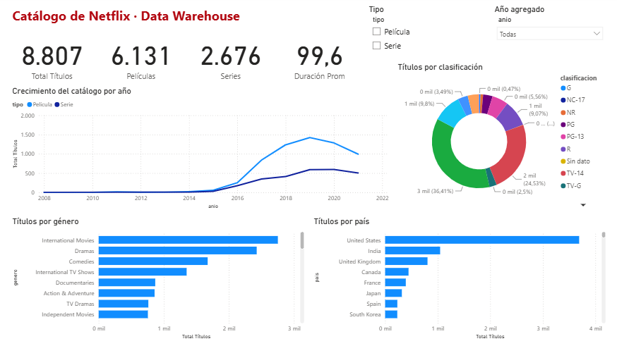

# Airbyte · Películas · Data Warehouse (TP)

Pipeline ELT del catálogo de Netflix (8.807 títulos):

```
netflix_titles.csv (GitHub) ──Airbyte──▶ PostgreSQL raw.netflix_titles ──SQL──▶ esquema dw (estrella) ──▶ Power BI
```

## 1. Data warehouse (PostgreSQL en Docker)

```bash
docker run -d --name netflix-dw -e POSTGRES_USER=netflix -e POSTGRES_PASSWORD=<tu_password> \
  -e POSTGRES_DB=netflix_dw -p 5434:5432 --restart unless-stopped postgres:16
```

## 2. Airbyte (`abctl local install`, UI en http://localhost:8000)

| Pieza | Configuración |
|---|---|
| **Source** `File` | URL `https://raw.githubusercontent.com/LuisDefv/Airbyte-Peliculas-DatawareHouse-TP/main/netflix_titles.csv`, formato CSV, provider HTTPS, dataset `netflix_titles` |
| **Destination** `Postgres` | host `host.docker.internal`, puerto `5434`, DB `netflix_dw`, schema `raw`, user `netflix`, SSL disabled |
| **Connection** | stream `netflix_titles`, *Full refresh – Overwrite*, schedule manual |

## 3. Modelo estrella

```bash
docker exec -i netflix-dw psql -U netflix -d netflix_dw < sql/01_modelo_dw.sql
```

Son vistas sobre `raw`, así que cada sync de Airbyte actualiza el DW automáticamente.

| Vista | Rol |
|---|---|
| `dw.fact_titulos` | Hechos: un título por fila (tipo, clasificación, duración, temporadas, año, fecha agregado) |
| `dw.dim_fecha` | Fecha en que se agregó a Netflix (año, trimestre, mes) |
| `dw.dim_genero` + `dw.bridge_titulo_genero` | Géneros (N a N) |
| `dw.dim_pais` + `dw.bridge_titulo_pais` | Países (N a N) |

## 4. Power BI

El dashboard está guardado como **proyecto de Power BI** en `powerbi/NetflixDashboard.pbip` (formato de texto: modelo en TMDL y reporte en PBIR, versionable en git).

1. Abrir `powerbi/NetflixDashboard.pbip` con Power BI Desktop.
2. **Inicio → Actualizar**. La primera vez pide credenciales **Base de datos**: usuario `netflix` y la contraseña del contenedor. Si pregunta por cifrado, aceptar sin cifrar.
3. Listo: el modelo (6 vistas del esquema `dw`, relaciones y medidas) y el reporte ya vienen armados.



Para armarlo desde cero en vez de usar el proyecto: abrir `powerbi/netflix_dw.pbids`, cargar las 6 vistas de `dw` y configurar lo siguiente.

4. En **Vista de modelo**, relaciones:
   - `dim_fecha[fecha_key]` 1 → * `fact_titulos[fecha_key]`
   - `fact_titulos[show_id]` 1 → * `bridge_titulo_genero[show_id]` (filtro cruzado **ambos**)
   - `dim_genero[genero]` 1 → * `bridge_titulo_genero[genero]`
   - `fact_titulos[show_id]` 1 → * `bridge_titulo_pais[show_id]` (filtro cruzado **ambos**)
   - `dim_pais[pais]` 1 → * `bridge_titulo_pais[pais]`
5. Medidas DAX (en `fact_titulos`):

```DAX
Total Títulos   = COUNTROWS(fact_titulos)
Películas       = CALCULATE([Total Títulos], fact_titulos[tipo] = "Película")
Series          = CALCULATE([Total Títulos], fact_titulos[tipo] = "Serie")
% Películas     = DIVIDE([Películas], [Total Títulos])
Duración Prom   = AVERAGE(fact_titulos[duracion_min])
Temporadas Prom = AVERAGE(fact_titulos[temporadas])
```

### Visuales del dashboard
- **Tarjetas**: Total Títulos (8.807), Películas (6.131), Series (2.676), Duración Prom (99,6 min).
- **Líneas**: Total Títulos por `dim_fecha[anio]` (leyenda `tipo`) → crecimiento del catálogo.
- **Barras**: Total Títulos por `dim_genero[genero]` y por `dim_pais[pais]`, ordenadas de mayor a menor.
- **Anillo**: Total Títulos por `clasificacion`.
- **Segmentadores**: tipo y año agregado.

## Cómo levantar todo de nuevo

1. Ejecutar `..\Prender Airbyte.bat` como administrador. Prende Docker y Airbyte.
2. El Postgres `netflix-dw` arranca solo con Docker (`--restart unless-stopped`). Si no, correr `docker start netflix-dw`.
3. Abrir `powerbi\NetflixDashboard.pbip` y **Actualizar**.
